## Avant l'« IA »

Le terme « IA », devenu un mot à la mode, est aujourd'hui partout et utilisé par presque tout le monde.
Mais il n'est que l'évolution d'autres termes à la mode utilisés auparavant dans les années 2010, comme :

- « exploration de données » (*data mining*)
- « mégadonnées » (*big data*)
- « science des données » (*data science*)
- « apprentissage profond » (*deep learning*)
- « apprentissage automatique » (*machine learning*)

## Alors, qu'est-ce que l'IA ?

L'IA (intelligence artificielle), au sens général, est :
\
\
\
La capacité d'une **machine** à effectuer des tâches qui **nécessiteraient de l'intelligence** si elles étaient réalisées par un **être humain**.

## Quel âge a l'IA ?

Techniquement, un automate comme la servante automatique de [Philon de Byzance](https://en.wikipedia.org/wiki/Philo_of_Byzantium) (IIIe siècle av. J.-C.) pourrait donc être considéré comme une forme d'IA !

## La servante de Philon (vidéo)



## L'IA en informatique

Mais aujourd'hui, quand on parle d'IA, on désigne généralement le domaine de l'*informatique* qui cherche à construire des systèmes capables de comportements intelligents, d'apprentissage, de raisonnement et de résolution autonome de problèmes.

La machine est désormais un ordinateur.

## Un programme simple

Un **ordinateur** (la machine) exécute un ou plusieurs **programmes** qui reçoivent une entrée et produisent une sortie. Très souvent, un **programme** exécute un ou plusieurs **algorithmes**.

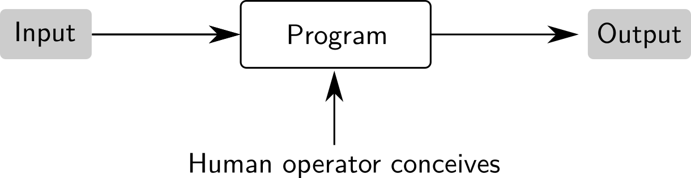{width="82%"}

## Algorithme ? Programme ?

- Un **algorithme** est un ensemble d'instructions que l'on peut suivre pour atteindre un objectif précis. Une recette de cuisine est donc un algorithme ! 🧁
```python
def double(lst):
    return [x * 2 for x in lst]
```

- Un **programme** est un ensemble d'instructions qui peuvent être exécutées par une machine. Il peut exécuter un algorithme, mais aussi faire beaucoup d'autres choses, comme afficher un message.
```python
print("Hello world! Let's double some numbers:")
double([1, 2, 3])
```

## Les pionnières et pionniers de l'IA

L'IA n'est pas née en 2020. Elle est le résultat d'une longue évolution des idées et des technologies.
\
\
De nombreuses personnes ont défini le concept de machine aux XIXe et XXe siècles. Rencontrons six de ces pionnières et pionniers.

## Joseph-Marie Jacquard (1752-1834)

[Jacquard](https://en.wikipedia.org/wiki/Joseph-Marie_Jacquard) a créé en 1801 la première machine programmable : le **métier à tisser Jacquard**, commandé par des cartes perforées. Il servait à tisser des motifs complexes et était un précurseur de l'informatique moderne.

::: {.columns}
::: {.column width="40%"}
{height="420"}
:::
::: {.column width="60%"}
{height="420"}
:::
:::

## Les révoltes contre le métier Jacquard

Les canuts révoltés de Lyon ont détruit de nombreux métiers Jacquard en 1831, craignant que la machine ne remplace leur travail.


## Charles Babbage (1791-1871)

[Babbage](https://en.wikipedia.org/wiki/Charles_Babbage) a conçu en 1837 la [« machine analytique »](https://en.wikipedia.org/wiki/Analytical_engine) : le premier projet d'ordinateur polyvalent programmable à l'aide de cartes perforées.

::: {.columns}
::: {.column width="40%"}
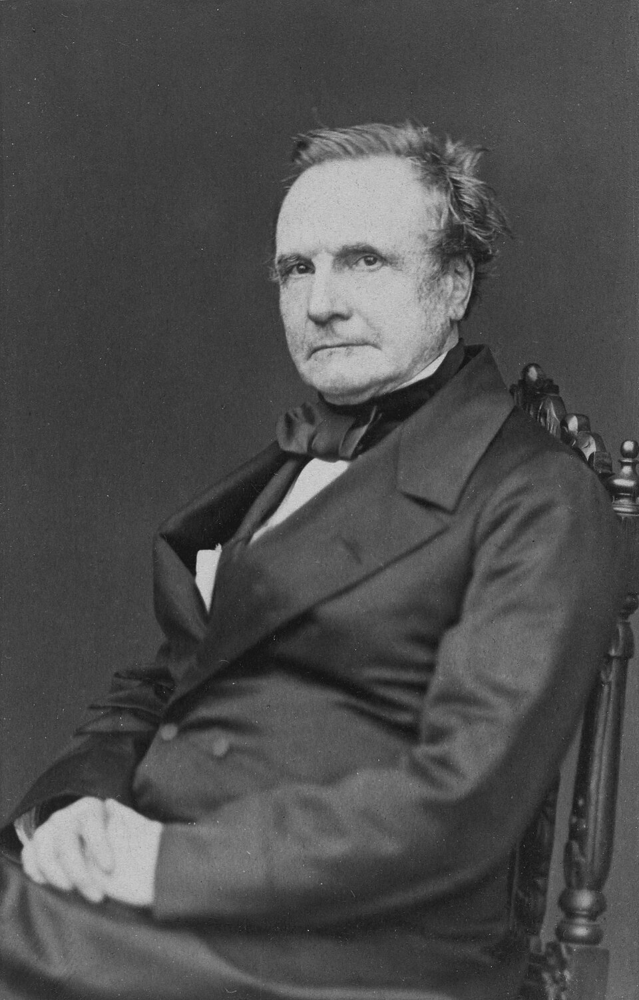{height="420"}
:::
::: {.column width="60%"}
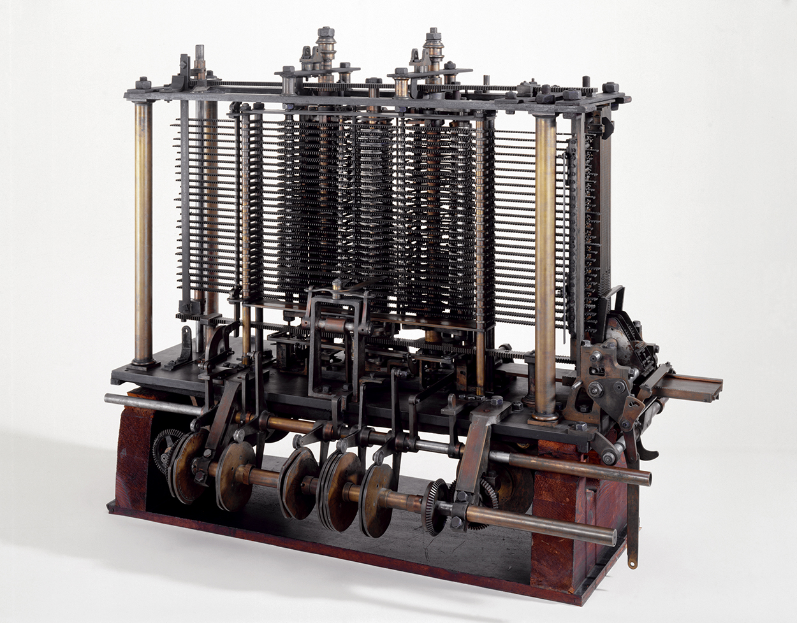{height="420"}
:::
:::

## Ada Lovelace (1815-1852)

[Lovelace](https://en.wikipedia.org/wiki/Ada_Lovelace) a écrit en 1843 le premier programme publié (note G) : un algorithme permettant de calculer les [nombres de Bernoulli](https://en.wikipedia.org/wiki/Bernoulli_number) sur la machine analytique.

::: {.columns}
::: {.column width="40%"}
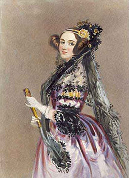{height="420"}
:::
::: {.column width="60%"}
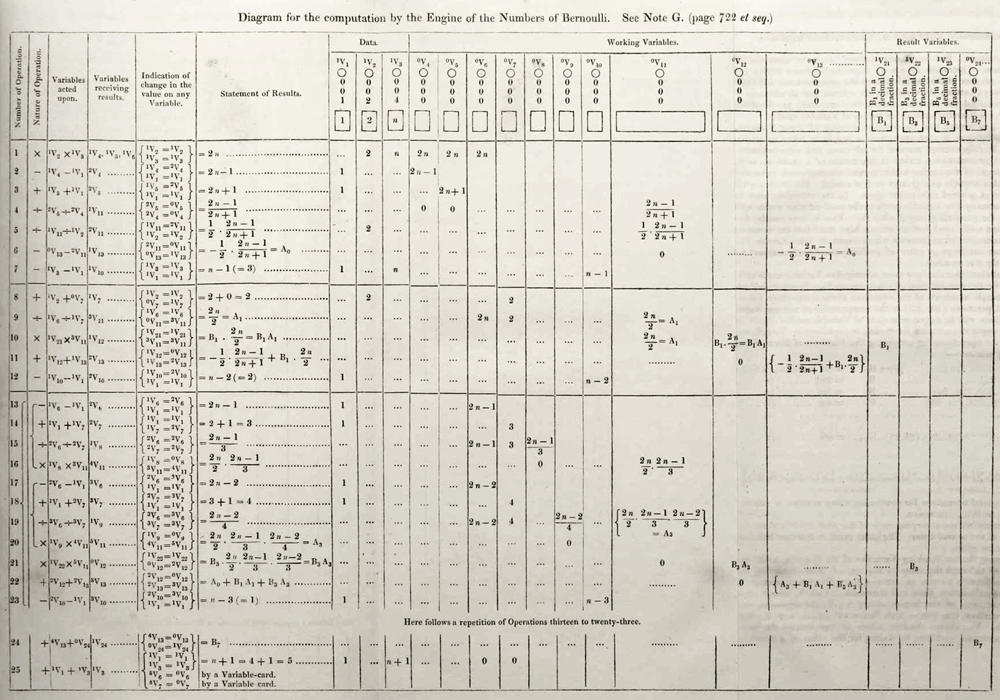{height="420"}
:::
:::

## Alan Turing (1912-1954)

[Turing](https://en.wikipedia.org/wiki/Alan_Turing) a défini en 1936 le concept de machine virtuelle universelle et affirmé qu'une machine peut simuler tout processus algorithmique.

::: {.columns}
::: {.column width="40%"}
{height="420"}
:::
::: {.column width="60%"}
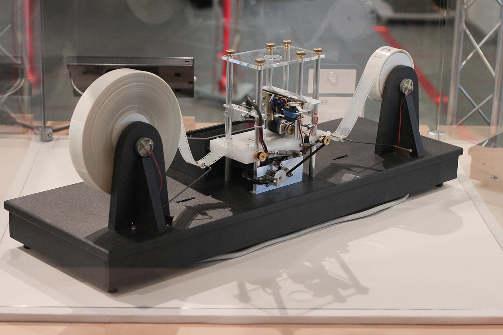{height="420"}
:::
:::

## John von Neumann (1903-1957)

[Von Neumann](https://en.wikipedia.org/wiki/John_von_Neumann) a défini en 1945 l'architecture d'un ordinateur : le programme et les données partagent la même mémoire.

::: {.columns}
::: {.column width="40%"}
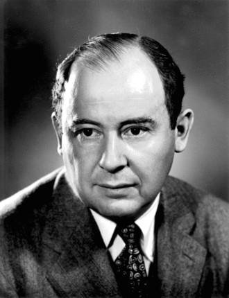{height="420"}
:::
::: {.column width="60%"}
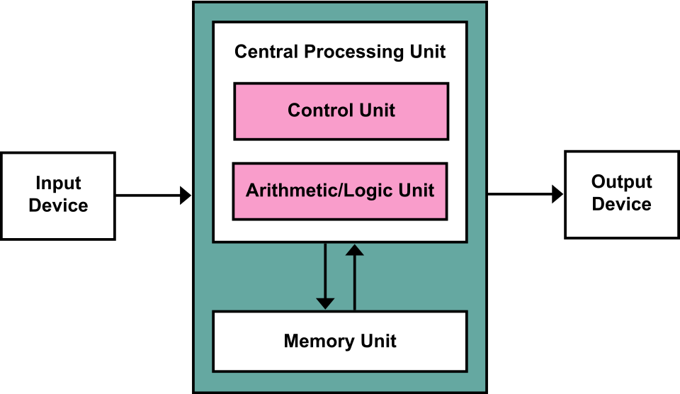{height="420"}
:::
:::

## Edsger Dijkstra (1930-2002)

[Dijkstra](https://en.wikipedia.org/wiki/Edsger_Dijkstra) était un pionnier de l'algorithmique. Son algorithme du plus court chemin (1956) est encore utilisé partout.

::: {.columns}
::: {.column width="40%"}
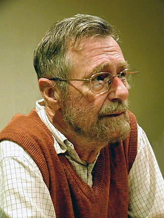{height="420"}
:::
::: {.column width="60%"}
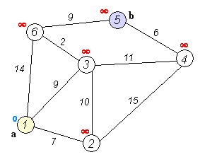{height="420"}
:::
:::

## De nombreux types d'IA

Le type d'IA le plus courant aujourd'hui repose sur l'**apprentissage automatique**, mais d'autres types d'IA n'y font pas appel : raisonnement symbolique, systèmes experts, représentation des connaissances, etc.
\
\
Des programmes comme [Mycin](https://en.wikipedia.org/wiki/Mycin) (1970) et [Deep Blue](https://en.wikipedia.org/wiki/Deep_Blue_(chess_computer)) (1997) sont des exemples d'IA qui ne reposent pas sur l'apprentissage automatique.

## Apprentissage automatique

L'**apprentissage automatique** est un domaine de l'IA qui développe des algorithmes et des modèles permettant aux ordinateurs d'apprendre à partir de **données** et de faire des prédictions ou de prendre des décisions sans être explicitement programmés pour cela.
\
\
C'est le domaine qui a le plus progressé ces dernières années, grâce à la disponibilité de **grands ensembles de données** et de **ressources de calcul** puissantes.

## Premier programme d'apprentissage automatique

L'un des premiers programmes d'apprentissage automatique a été créé par [Arthur Samuel](https://en.wikipedia.org/wiki/Arthur_Samuel_(computer_scientist)) en 1952. Il s'agissait d'un jeu de dames qui apprenait à mieux jouer en jouant contre lui-même.

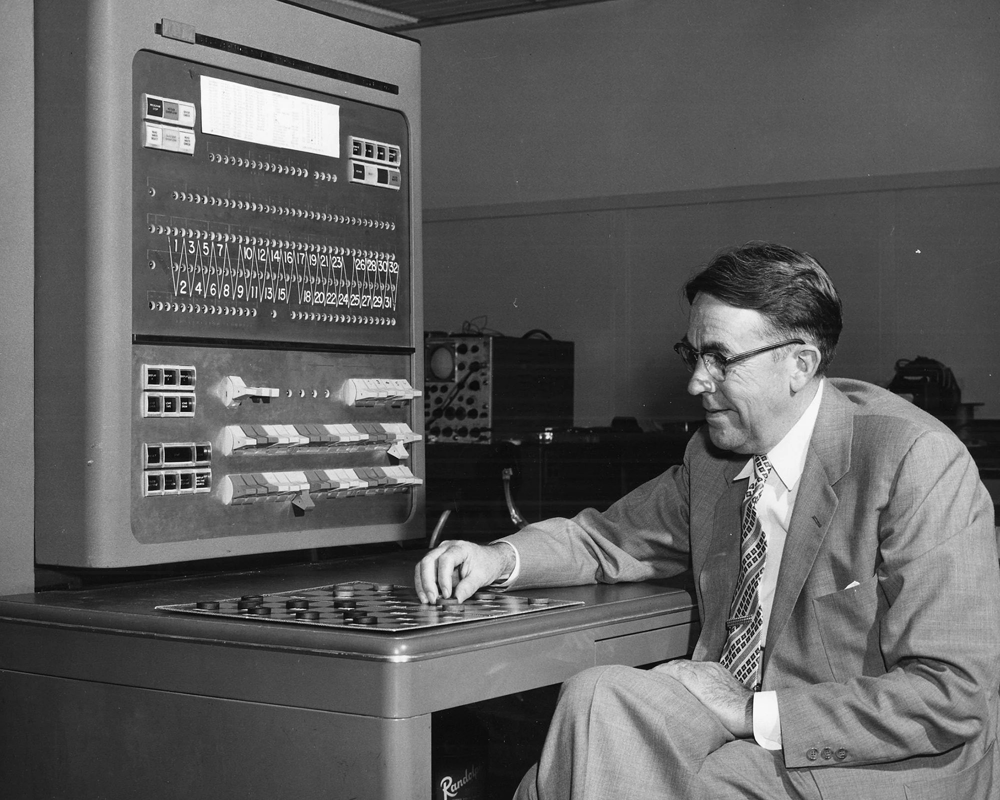

## IA, apprentissage automatique et apprentissage profond

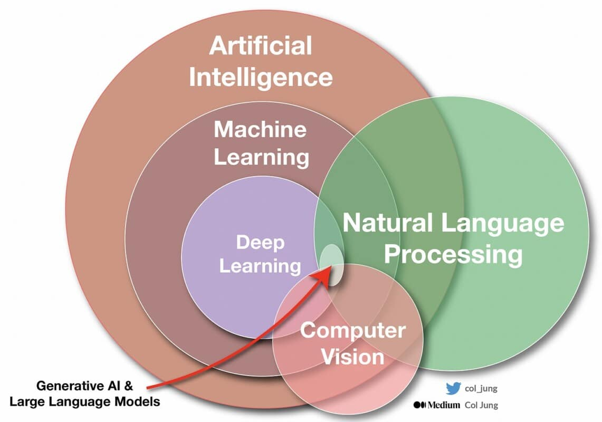

## Essor de l'IA (1950-1970)

- Perceptron : une première tentative de classification d'images (1958) par [Frank Rosenblatt](https://en.wikipedia.org/wiki/Frank_Rosenblatt).
- L'IA reposait alors principalement sur le raisonnement symbolique, et non sur les données.
- De 1950 à 1970, de nombreuses personnes étaient trop optimistes quant à l'avenir de l'IA. Elles pensaient qu'une machine pourrait devenir intelligente en quelques années.

## Qu'est-ce que le raisonnement symbolique ?

Le raisonnement symbolique est une forme d'intelligence artificielle qui utilise des symboles et des règles pour représenter et manipuler des connaissances. Par exemple, un système simple fondé sur des règles pourrait utiliser les règles suivantes :

> S'il pleut, le sol est mouillé.  
> Si le sol est mouillé, l'herbe est verte.  
> Donc, s'il pleut, l'herbe est verte.

À partir de ces règles, le système peut déduire que s'il pleut, l'herbe est verte.

## Hiver de l'IA (1970-1980)

Dans les années 1970 et 1980, les financements et l'intérêt pour la recherche en IA ont diminué. Les attentes étaient trop optimistes et le domaine n'a pas pu tenir ses promesses.

## Années 1980 : progrès de la modélisation

Les années 1980 ont néanmoins vu des progrès dans les techniques de modélisation et d'entraînement. Mais les données nécessaires pour entraîner les modèles étaient insuffisantes.

## Années 1990-2000

- L'IA passe du raisonnement symbolique à l'apprentissage automatique à partir de données.
- Les modèles étaient alors assez simples pour être analysés (SVM et modèles linéaires généralisés).
- Premières applications : reconnaissance de caractères, etc.
- Progrès dans la modélisation des comportements, comme l'algorithme de *recommandation de Netflix* appelé « Cinematch » (2000).

## Le tournant de 2010

- Un modèle fondé sur des réseaux de neurones profonds est entraîné sur [ImageNet](https://en.wikipedia.org/wiki/ImageNet) et remporte le défi ImageNet en 2012. C'est le début d'un nouvel essor de l'IA. Les trois gagnants étaient Alex Krizhevsky, Ilya Sutskever et Geoffrey Hinton.

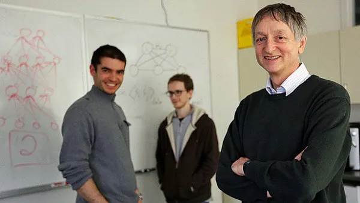{width="70%"}
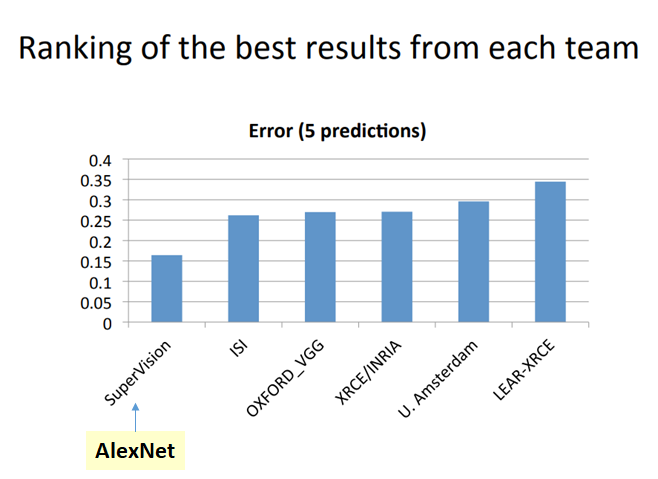{width="70%"}

## Pourquoi l'apprentissage profond fonctionne-t-il aujourd'hui ?

- De grands ensembles de données sont disponibles.
- Progrès du calcul parallèle (GPU).
- Progrès des frameworks de programmation (TensorFlow, PyTorch, JAX, etc.).

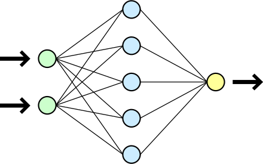{width="48%"}

::: {.columns}
::: {.column width="42%"}
**Puissance de calcul**

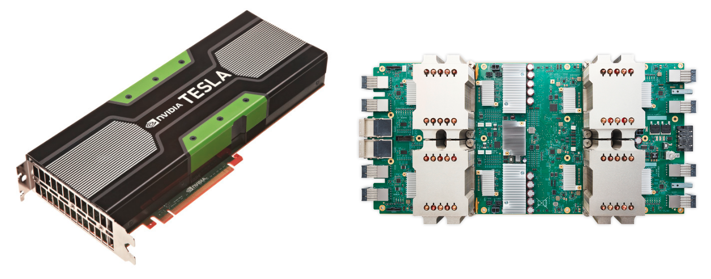{width="90%"}
:::
::: {.column width="58%"}
**Frameworks de programmation puissants**

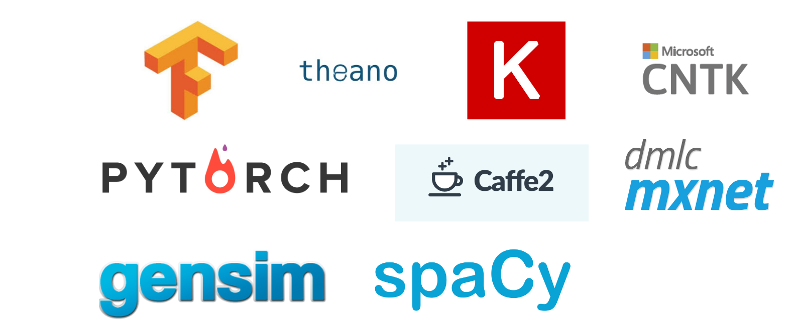{width="94%"}
:::
:::

## Après 2010 : essor de l'apprentissage profond (IA générative)

Aujourd'hui, l'apprentissage automatique est utilisé dans de nombreux domaines, mais les résultats les plus spectaculaires, du moins aux yeux du grand public, concernent l'**apprentissage profond**.

Après leur entraînement, ces modèles peuvent générer des images, du texte, de la musique et même du code. Ils peuvent aussi jouer à des jeux, prédire la structure des protéines, et bien plus encore.

## Images

Classification, détection et génération d'images.
Ex. : DALL-E (2021), MidJourney (2022), Stable Diffusion (2022).

## Parole

Transcription, synthèse et interfaces vocales. Ex. : Whisper, VALL-E, ChatGPT vocal.

## Jeux

Systèmes qui apprennent des stratégies en jouant contre eux-mêmes. Ex. : AlphaGo, OpenAI Five, MuZero.

## Biologie

Prédiction de la structure des protéines. Ex. : AlphaFold, RoseTTAFold.

## Audio

Génération de musique et synthèse sonore. Ex. : Jukebox, Riffusion, AudioLM, Suno.

## Langage

Traduction, résumé et génération de texte. Première génération : Bert (2018), GPT-3 (2020), T5 (2019).

Deuxième génération : GPT-3.5 (2022), LLaMA (2023), Claude (2023), Gemini (2023), DeepSeek-R1 (2025).

## Investissement dans l'IA

Ces modèles coûtent très cher à entraîner et à déployer. Les investissements dans l'IA sont considérables et les principaux acteurs sont les GAFAM (Google, Apple, Facebook, Amazon, Microsoft) et le gouvernement chinois.

En Europe, les investissements sont beaucoup plus faibles, mais certains pays tentent de rattraper leur retard (France, Allemagne, Royaume-Uni).

::: {.columns}
::: {.column width="50%"}
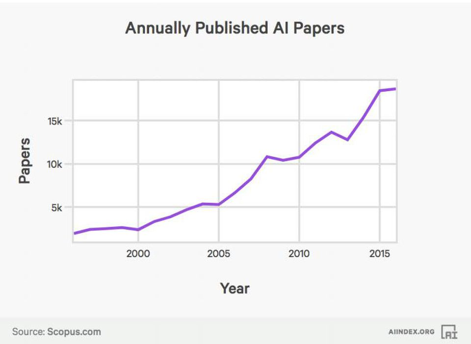{width="90%"}
:::
::: {.column width="50%"}
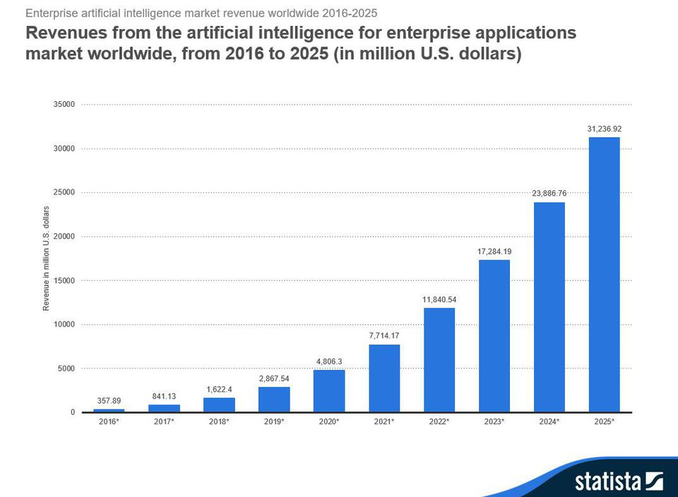{width="90%"}
:::
:::

## Zoom sur les LLM

Après son entraînement, un grand modèle de langage (LLM) peut générer du texte, répondre à des questions, traduire, résumer du texte, et bien plus encore.

[LLM Explorer](https://chyams-llm-explorer.hf.space/)

## Quelques éléments à connaître sur les LLM

- La taille du modèle se mesure en paramètres : des milliards de paramètres pour les plus grands modèles.
- Un paramètre est un poids du réseau de neurones appris pendant l'entraînement.

Dans ce contexte, poids et paramètres désignent la même chose.

## Du texte aux jetons

Les LLM ne traitent pas directement des mots ou des phrases. Ils traitent des séquences de **jetons** (*tokens*).

Un jeton est une unité de texte produite par un outil de tokenisation.

Selon cet outil, un jeton peut représenter :

- Un mot complet
- Une partie d'un mot
- Un signe de ponctuation
- Un nombre ou une suite de caractères

## Exemple de jetons

Par exemple :

```text
"Large Language Models are powerful."
```

pourrait être découpé en jetons ainsi :

```text
["Large", " Language", " Models", " are", " powerful", "."]
```

## Identifiants des jetons

Chaque jeton est associé à un identifiant entier.

```text
["Large", " Language", " Models"]
          ↓
[  4532,       982,     18273]
```

Le modèle traite ces identifiants numériques, et non le texte d'origine.

## Pourquoi la tokenisation est-elle importante ?

- Les modèles disposent d'un vocabulaire fixe.
- Le nombre de jetons détermine la longueur du contexte.
- Différentes langues et écritures peuvent nécessiter des nombres de jetons différents.
- L'utilisation et la tarification des API dépendent souvent du nombre de jetons.

## Des identifiants aux représentations vectorielles

Les identifiants de jetons sont des entiers discrets. Les réseaux de neurones ont besoin de vecteurs numériques pour traiter l'information.

Chaque identifiant de jeton est donc associé à un vecteur dense appelé **embedding** ou représentation vectorielle.

### Exemple d'embedding

Par exemple, un vocabulaire de 50 000 jetons et une dimension d'embedding de 4 096 nécessitent une matrice d'embeddings :

$$
E \in \mathbb{R}^{50000 \times 4096}
$$

Chaque ligne correspond à un jeton.

Une séquence d'identifiants :

$$
[4532, 982, 18273]
$$

devient une matrice :

$$
X \in \mathbb{R}^{3 \times 4096}
$$

Chaque ligne est une représentation vectorielle d'un jeton.

## Que représentent les embeddings ?

Les embeddings sont des représentations numériques apprises.

Pendant l'entraînement, le modèle les ajuste pour qu'ils deviennent utiles à la prédiction des jetons en contexte.

Ils peuvent encoder des relations sémantiques, syntaxiques et statistiques, même si leurs dimensions individuelles n'ont généralement pas de signification simple et lisible pour un humain.

**Important :** les embeddings ne sont pas des définitions de dictionnaire. Ce sont des représentations numériques apprises par le modèle.

## L'architecture Transformer

Les LLM modernes reposent principalement sur l'**architecture Transformer**, présentée dans l'article de 2017 :

*Attention Is All You Need* — Vaswani et al.

Un Transformer composé uniquement d'un décodeur, souvent utilisé pour générer du texte, comprend plusieurs couches successives.

## Une architecture simplifiée

```text
Jetons d'entrée
     |
Embeddings des jetons
     |
Information de position
     |
Bloc Transformer 1
     |
Bloc Transformer 2
     |
     ...
     |
Bloc Transformer N
     |
Projection de sortie
     |
Probabilités du jeton suivant
```

La même architecture est appliquée à plusieurs reprises, avec des paramètres appris différents dans chaque couche.

## Exemples de configurations de modèles

| Modèle | Couches | Dimension cachée |
|---|---:|---:|
| GPT-2 Small | 12 | 768 |
| GPT-2 Large | 36 | 1 280 |
| GPT-3 | 96 | 12 288 |

Ce sont des exemples de dimensions d'architecture, et non des mesures de la qualité des modèles.

## Pourquoi la position est-elle importante ?

Une séquence d'embeddings ne représente pas nécessairement à elle seule l'ordre des jetons.

Comparez :

- « Le chien mord l'homme. »
- « L'homme mord le chien. »

Les mêmes mots apparaissent, mais leur ordre change le sens.

## Paramètres, poids et taille des modèles

Un réseau de neurones contient des valeurs numériques apprises pendant l'entraînement.

On les appelle les **paramètres**.

Ils comprennent :
- Les matrices d'embeddings
- Les matrices de projection des requêtes, clés et valeurs
- Les projections de sortie de l'attention
- Les poids et biais des réseaux à propagation avant
- Les paramètres de normalisation
- Les paramètres de projection de sortie

## Que sont les poids ?

Considérons une transformation linéaire :

$$
y = Wx+b
$$

- $W$ contient les poids.
- $b$ contient les biais.
- Les deux sont des paramètres appris.

Au sens strict, les poids ne sont qu'une catégorie de paramètres. Dans l'usage courant, les « poids d'un modèle » désignent souvent l'ensemble des paramètres appris.

## Pourquoi parle-t-on de modèles 7B, 70B ou 400B ?

Ce nombre indique le nombre approximatif de paramètres, en milliards.

Par exemple, Claude Opus 2 possède 70 milliards de paramètres, tandis que GPT-4 en possède 175 milliards.

**Un plus grand nombre de paramètres ne signifie pas automatiquement de meilleures performances.**

## Des états cachés aux distributions de probabilités

Après avoir traversé toutes les couches du Transformer, le modèle produit une représentation finale pour la position actuelle.

Une projection de sortie transforme cette représentation en un score, appelé **logit**, pour chaque jeton du vocabulaire.

Pour un vocabulaire de 50 000 jetons :

$$
z \in \mathbb{R}^{50000}
$$

## Logits et probabilités

Les logits sont convertis en probabilités à l'aide de la fonction softmax :

$$
P(token_i)
=
\frac{e^{z_i}}{\sum_j e^{z_j}}
$$

Exemple :

| Jeton candidat | Probabilité |
|---|---:|
| Paris | 0.91 |
| Lyon | 0.03 |
| Marseille | 0.01 |
| London | 0.005 |
| Autres jetons | 0.045 |

La somme des probabilités est égale à 1.

## 8. Décodage : comment le modèle choisit-il le jeton suivant ?

Le modèle produit une distribution de probabilités, mais plusieurs stratégies permettent de sélectionner le jeton suivant.

## Décodage glouton

Sélectionne toujours le jeton le plus probable.

$$
token_{next} = \arg\max_i P(token_i)
$$

Cette méthode est simple et déterministe, mais elle peut produire un texte répétitif ou prévisible.

## Température

La température modifie les logits avant l'application de softmax :

$$
P(token_i)
=
\frac{\exp(z_i/T)}
{\sum_j \exp(z_j/T)}
$$

- Température basse : concentre la probabilité sur les jetons les plus probables.
- Température élevée : produit une distribution plus uniforme et davantage de variations.
- Température proche de zéro : se rapproche de la sélection gloutonne.

## Échantillonnage top-k

Limite l'ensemble des candidats aux k jetons les plus probables.

## Échantillonnage top-p

Effectue la sélection dans le plus petit ensemble de jetons dont la probabilité cumulée atteint un seuil choisi.

Ces stratégies peuvent être combinées.

## Génération autorégressive et fenêtres de contexte

Les LLM génèrent généralement du texte de manière autorégressive.

Chaque nouveau jeton est donc prédit à partir du contexte précédent.

Exemple :

```text
Consigne :
"The capital of France is"

Étape 1 :
"The capital of France is" → " Paris"

Étape 2 :
"The capital of France is Paris" → " and"

Étape 3 :
"The capital of France is Paris and" → " is"

...
```

Le processus continue jusqu'à ce que :
- Un jeton spécial de fin de séquence soit généré.
- Une longueur maximale de sortie soit atteinte.
- Une autre condition d'arrêt soit déclenchée.

## Fenêtre de contexte

La fenêtre de contexte est le nombre maximal de jetons qu'un modèle peut traiter dans un même contexte d'entrée.

Elle comprend la consigne pertinente et les jetons générés.

Par exemple, un modèle doté d'une fenêtre de contexte de 32 000 jetons peut traiter un document beaucoup plus long qu'un modèle limité à 4 000 jetons, sous réserve de sa configuration et de son implémentation.

## Cache KV

Pendant la génération autorégressive, le modèle peut stocker les clés et valeurs calculées précédemment.

C'est ce qu'on appelle le **cache clé-valeur** (*Key-Value cache*).

Il évite de recalculer toutes les représentations d'attention précédentes à chaque étape de génération, ce qui améliore l'efficacité de l'inférence.

Le cache KV consomme toutefois de la mémoire, et sa taille augmente généralement avec la longueur du contexte.

## 10. Entraînement, adaptation et inférence

Il s'agit de trois étapes ou processus distincts.

## Pré-entraînement

Le modèle apprend à partir de grands ensembles de données textuelles.

Un objectif courant est la prédiction du jeton suivant :

$$
\mathcal{L}
=
-\sum_{t=1}^{T}
\log P(x_t \mid x_1,\ldots,x_{t-1})
$$

Le modèle ajuste ses paramètres pour réduire l'erreur de prédiction.

Cette opération est coûteuse en calcul et nécessite beaucoup de données et de matériel.

## Adaptation et alignement

Un modèle pré-entraîné peut être adapté davantage.

Par exemple :
- Adaptation supervisée (*supervised fine-tuning*, SFT)
- Optimisation des préférences
- Approches fondées sur l'apprentissage par renforcement

Ces techniques peuvent améliorer le respect des consignes, le comportement conversationnel ou les performances sur certaines tâches.

## Inférence

L'inférence consiste à utiliser un modèle déjà entraîné pour générer des prédictions.

Lorsque vous envoyez une consigne à ChatGPT, DeepSeek ou à un modèle local exécuté avec Ollama, vous effectuez une inférence.

**Distinction essentielle :**

- L'entraînement modifie les paramètres du modèle.
- L'inférence utilise les paramètres existants pour produire des résultats.

## Et ensuite ?

En 2023, lorsque ChatGPT 3.5 est sorti, c'était un simple agent conversationnel qui ne pouvait pas accéder au Web ni à d'autres outils.

Les LLM ont ensuite évolué pour devenir des agents IA multimodaux capables d'accéder à des outils, systèmes et sources de données externes.

## Agents IA multimodaux

À partir d'un LLM, on peut construire un agent IA en ajoutant :
- Un **moteur de raisonnement** pour planifier et prendre des décisions.
- Un **module d'utilisation d'outils** pour interagir avec des systèmes externes, des API ou des bases de données.
- Un **module de mémoire** pour stocker et retrouver des informations au fil du temps.

On peut ainsi utiliser différents LLM avec un même agent IA, selon la tâche.

## MCP

Le Model Context Protocol (MCP) est un standard ouvert et un cadre open source introduit par Anthropic en novembre 2024 pour standardiser la manière dont les systèmes d'intelligence artificielle, comme les grands modèles de langage (LLM), intègrent et partagent des données avec des outils, systèmes et sources de données externes.


## MCP et confidentialité

MCP est un protocole, tout comme HTTP est un protocole du Web. S'il est bien configuré, il peut empêcher un agent IA d'accéder à des données auxquelles il ne devrait pas accéder ou de les modifier.

## Programmer avec l'IA

Des outils comme GitHub Copilot, Claude Code ou Cursor peuvent écrire du code ou vous aider à le faire. Ils utilisent des LLM spécialisés qui ont été entraînés sur du code et des langages de programmation.

## Vibe coding

Le terme *vibe coding* a été popularisé par [Andrej Karpathy](https://en.wikipedia.org/wiki/Andrej_Karpathy) en 2025.

Il désigne une pratique de développement logiciel assistée par l'intelligence artificielle dans laquelle la personne qui développe décrit un projet ou une tâche en langage naturel à un LLM, qui génère automatiquement le code source.

## Avantages de la programmation assistée par IA 1

- Elle peut accélérer le développement en générant du code répétitif ou standard.
- Elle peut aider à apprendre de nouveaux langages ou frameworks grâce à des exemples et à des explications.
- Elle peut faciliter le débogage en suggérant des corrections ou en identifiant des problèmes potentiels dans le code.

## Avantages de la programmation assistée par IA 2

- Elle peut aider les personnes qui ne développent pas à créer une preuve de concept (POC) ou un prototype.
- Elle rend réalisables des projets qui seraient trop coûteux à développer sans assistance par IA.
- Elle peut permettre aux développeurs et développeuses de se concentrer sur la conception générale et la résolution de problèmes plutôt que sur les détails d'implémentation.

## Limites du vibe coding

Pour une personne qui ne développe pas et souhaite créer une preuve de concept (POC) ou un prototype, le *vibe coding* peut être une bonne solution.

Mais cela peut facilement mener à une catastrophe si cette personne veut créer un logiciel de production. Le code généré peut contenir des bugs, être vulnérable ou difficile à maintenir.

https://ludditus.com/2025/03/26/not-everyone-is-dumb/

## Limites de la programmation avec l'IA

- Sécurité : le code généré peut être vulnérable aux attaques (fausses bibliothèques, portes dérobées, etc.).
- Maintenabilité : le code généré peut être difficile à lire, à comprendre et à maintenir.
- Performance : le code généré peut être inefficace et lent.
- Architecture : le code généré peut ne pas respecter les bonnes pratiques et les patrons de conception.
- Aspects juridiques : le code généré peut enfreindre des droits d'auteur ou des licences.

## Impact de l'IA

L'IA touche déjà de nombreux aspects de nos vies, de la santé à la finance, en passant par l'éducation et le divertissement. Voici quelques-uns de ses impacts les plus importants.

## Automatisation des emplois et des tâches

Le monde a connu plusieurs révolutions industrielles, et la révolution actuelle modifiera directement notre façon de travailler. De nombreux emplois et tâches seront automatisés, ce qui transformera le marché du travail et créera des besoins en nouvelles compétences.

## Chômage et inégalités économiques

À mesure que les emplois sont automatisés, le chômage et les inégalités économiques risquent d'augmenter. Les personnes incapables de s'adapter à l'évolution du marché du travail pourraient perdre leur emploi, tandis que celles qui possèdent les compétences nécessaires pourraient voir leurs salaires augmenter.

## D'une économie fondée sur le travail à une économie fondée sur le capital

À mesure que l'IA et l'automatisation prennent en charge davantage de tâches, l'économie passe d'un modèle fondé sur le travail à un modèle fondé sur le capital. Cela signifie que les propriétaires de systèmes et de technologies d'IA recevront une part plus importante des richesses, tandis que les personnes qui vivent de leur travail pourraient voir leurs revenus diminuer.

## Progrès mathématiques et scientifiques

Le 6 octobre 2026, OpenAI a publié 722 nouveaux articles mathématiques en une seule journée. L'IA transforme le monde des mathématiques et de la science.

Hugo Duminil-Copin n'est pas opposé à l'IA, mais critique vivement l'approche d'OpenAI concernant la publication de travaux mathématiques générés par l'IA.

Il défend une approche plus responsable : l'IA doit soutenir les mathématiciennes et mathématiciens, sans remplacer la créativité humaine, la compréhension et la transmission des connaissances.

## Recherche et développement autonomes

L'IA est désormais capable de mener des activités de recherche et développement de manière autonome, sans intervention humaine. Cela pourrait accélérer les découvertes scientifiques et l'innovation, mais soulève aussi des questions éthiques sur la recherche menée par l'IA.

## Sécurité et confidentialité

Les nouveaux modèles d'IA sont très efficaces pour détecter les failles de sécurité et les vulnérabilités, mais ils peuvent aussi servir à créer de nouveaux types d'attaques.

## Souveraineté et contrôle

Les modèles d'IA les plus puissants sont contrôlés par quelques grandes entreprises américaines : OpenAI, Google, Microsoft, Meta, Anthropic, etc. Cette concentration du pouvoir soulève des questions de souveraineté et de contrôle sur les technologies d'IA.

## Crédits

Ce diaporama a été créé par [virgilus](https://github.com/virgilus) avec Quarto, en s'inspirant des cours du programme [Data Science and Machine Learning](https://github.com/data-psl/lectures2025). Les auteurs d'origine de ce programme comprennent Arthur Mensch, Zaccharie Ramzi et Hugo Richard.
